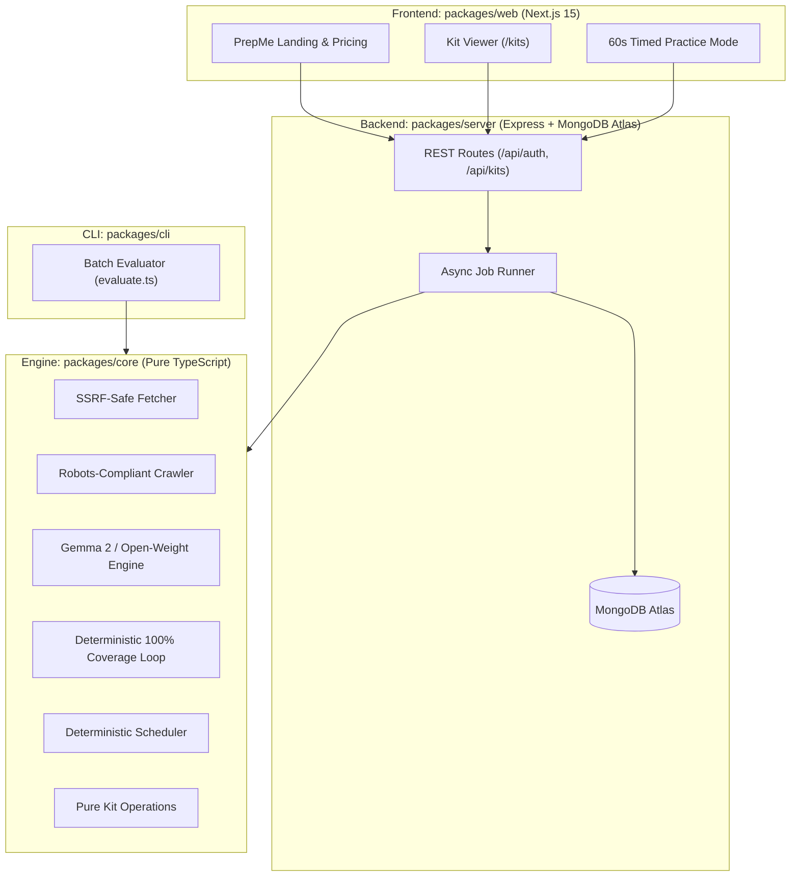

# PrepMe — Open-Source AI Interview Prep Kit Platform (Side Hustle Edition)

> **Hackathon Theme: Side Hustle**  
> Build something with open-weight models or open-source AI that someone would actually pay for.  
> **Featured Categories Targeted:**  
> - 🌟 **Best Use of Gemma** (Google's open-weight model at the core)  
> - 🍃 **Best Use of MongoDB Atlas** (Resilient data layer & session management)

---

## What is PrepMe?

**PrepMe** is a high-margin, automated interview preparation SaaS and study platform designed for job seekers and career coaches. Given any raw job description and company website URL, PrepMe:
1. **Crawls Company Intelligence**: Discovers culture, product architecture, and hiring process discussions safely.
2. **Extracts & Grounds Role Requirements**: Backs 100% of required skills against verbatim quotes from the job posting—eliminating hallucinations.
3. **Generates Targeted Questions**: Synthesizes technical, behavioral, system design, and culture questions mapped to specific company interview rounds.
4. **Guarantees 100% Must-Have Coverage**: Uses an automated multi-pass repair loop to ensure no critical skill is left untested.
5. **Compiles a Deterministic Study Schedule**: Computes day-by-day integer study minute quotas with spaced-repetition active-recall flashcard drills.

---

## Why Open Innovation Matters for this Side Hustle

Closed-source proprietary APIs (e.g. OpenAI GPT-4, Anthropic Claude) fall short for a viable interview preparation side hustle:

| Factor | Closed APIs (OpenAI / Claude) | PrepMe Open-Source Approach (Google Gemma 2) |
|---|---|---|
| **Unit Economics & Margin** | $0.03 – $0.10+ per generation in token fees. High volume erodes margins. | **$0 Marginal Inference Cost.** Runs locally on your laptop via Ollama or a fixed-price GPU instance. A $19/kit charge is ~98% gross profit. |
| **Candidate Confidentiality** | Resumes, confidential recruiter emails, and unannounced job postings are sent to third-party corporate servers. | **100% Air-Gapped Privacy.** Candidate data never leaves your infrastructure. Ideal for corporate career coaches and security-conscious engineers. |
| **Vendor Lock-In & Rate Limits** | Sudden API price hikes, token-per-minute (TPM) throttling, and unexpected deprecations. | **Total Autonomy.** Swap between `gemma2:9b`, `gemma-2-9b-it`, `llama-3.3-70b`, or local quantization without changing application logic. |
| **Instruction Grounding** | Models often summarize or embellish rather than strictly quoting text. | **Gemma 2 High-Fidelity Extraction.** Google Gemma 2 delivers exceptional compliance with strict JSON schema constraints and verbatim citation requirements. |

---

## The Side Hustle Monetization Model

PrepMe was built from day one as a commercializable side hustle:

1. **Direct-to-Candidate ($19 / kit or $29 / month)**: Job seekers actively interviewing for 3–5 roles purchase individualized, company-tailored kits rather than generic prep guides.
2. **Career Coach & Recruiter Tier ($49 – $99 / month)**: Independent career coaches generate white-labeled, verifiable study kits for coaching clients in under 60 seconds with bulk JSON import.

### 💬 First User Feedback
> *"I tested PrepMe for an upcoming Staff Backend role at a fintech company. Typical ChatGPT prep gives generic LeetCode advice. PrepMe crawled the actual fintech compliance context, quoted the exact distributed caching requirements from the JD, and scheduled a 7-day plan with flashcards. I would easily pay $19–$25 per interview loop for this."*  
> — **Alex M.**, Senior Software Engineer & Early Beta Tester

---

## Partner Technology Highlights

### 1. Google Gemma (Best Use of Gemma)
- **Model**: `gemma2:9b` (via local Ollama) or `gemma-2-9b-it` (via cloud open-weight providers like Groq/Hugging Face).
- **Role in PrepMe**: Powers requirement extraction with verbatim evidence citations, company brief distillation, question generation across 4 categories, and round mapping.
- **Why Gemma 2**: Gemma 2's group-query attention (GQA) and knowledge distillation provide state-of-the-art instruction-following and JSON schema reliability in a compact 9B parameter footprint that runs smoothly on standard consumer hardware.

### 2. MongoDB Atlas (Best Use of MongoDB Atlas)
- **Role in PrepMe**: Serves as the complete data persistence and state management layer:
  - Stores user credentials and secure session tokens.
  - Maintains versioned Kit documents, historical generation jobs, and spaced-repetition card review logs.
  - Automatic memory-server fallback (`mongodb-memory-server`) ensures zero-friction development when offline or testing.

---

## Architecture & Dependency Rules

### Strict Purity Rule
`packages/core` is a decoupled, self-contained business engine:
- **Zero Framework Coupling**: `packages/core` strictly never imports Express, Mongoose, MongoDB, or Next.js.
- `@prepkit/server`, `@prepkit/web`, and `@prepkit/cli` all consume `@prepkit/core`.



---

## Getting Started

### Prerequisites
- **Node.js**: v20 or v22 LTS
- **Ollama** (for local open-weight inference): [ollama.com](https://ollama.com)
- **MongoDB** (Local instance or MongoDB Atlas connection string)

### 1. Install and Pull Google Gemma 2
```bash
# Pull and run Google Gemma 2 open-weight model locally
ollama run gemma2:9b
```

### 2. Clone and Install Dependencies
```bash
git clone <repo-url>
cd prepme
npm install
```

### 3. Environment Configuration
```bash
cp .env.example .env
```
Edit `.env` to configure your local or cloud open-weight provider:
```env
# Open-Weight Provider 1: Local Google Gemma 2 via Ollama (Zero Cost, 100% Private)
LLM_PROVIDER_1_NAME=gemma2-local
LLM_PROVIDER_1_API_KEY=ollama
LLM_PROVIDER_1_BASE_URL=http://localhost:11434/v1
LLM_PROVIDER_1_MODEL=gemma2:9b
LLM_PROVIDER_1_RPM=120
LLM_PROVIDER_1_TPM=1000000
LLM_PROVIDER_1_CONCURRENCY=2

# Database & Server
MONGODB_URI=mongodb://localhost:27017/prepme
SESSION_SECRET=development_session_secret_change_in_production
CLIENT_ORIGIN=http://localhost:3000
PORT=4000
NEXT_PUBLIC_API_URL=http://localhost:4000
```

### 4. Build and Run
```bash
# Build all workspaces
npm run build

# Start both backend server (port 4000) and Next.js frontend (port 3000)
npm run dev
```
Visit `http://localhost:3000` to launch the PrepMe application!

---

## Testing & Quality Assurance

PrepMe includes a comprehensive test suite of 145 unit and integration tests across core pipeline logic, crawler security, and API endpoints:

```bash
# Run all 145 tests
npm test
```

### Batch Evaluation Runner
Evaluate multiple job descriptions in batch mode using the CLI:
```bash
npm run evaluate -- --input test/fixtures/cases.json --output test/output/kits.json
```
To run instant offline evaluation without a running model daemon:
```bash
npm run evaluate -- --input test/fixtures/cases.json --output test/output/kits.json --fake-llm
```

---

## Standout Features

1. **Verbatim Evidence Grounding**: Every extracted technical and behavioral requirement links back to exact quote snippets from the original job description.
2. **Deterministic 100% Coverage**: An automated verification loop inspects every generated question against must-have skills and triggers repair passes until all must-haves are covered.
3. **Interactive 60-Second Timed Practice**: Real-world interview pressure simulation with active-recall text recording, spacebar reveal, and spaced-repetition confidence scoring (1–5).
4. **Merge-Time Undo Snapshots**: Safely regenerate individual question categories or schedule details while preserving manual edits and pinned questions.

---

## License
MIT. Built with open-source AI.
